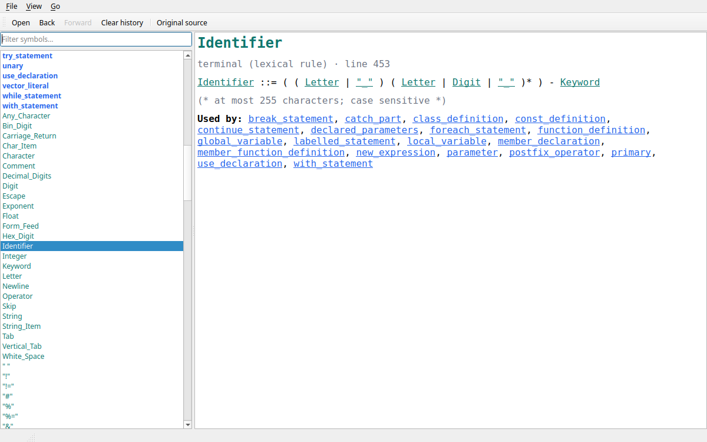

# syntax-viewer

Investigate grammars: load a Lark, EBNF, Yacc/Bison or Lemon file and browse
its rules as hyperlinked text.



- **Symbol list** (left): all non-terminals, terminals and undefined symbols,
  colour-coded. Filter by name (substring, or regular expression with `.*`)
  and by kind with the checkboxes.
- **Rule view** (right): the selected symbol's definition. Every symbol in it
  is a link: following it selects that symbol on the left and shows its
  definition.
- **Used by**: every rule that references the symbol, also as links.
- **Comments** next to a rule in the source are shown with it.
- **Normalised or original**: a uniform EBNF-like notation, or the rule as
  written in the file (with Yacc/Lemon actions stripped).
- **History**: back, forward and clear, like a browser.

## Supported formats

| Format | Extensions | Notes |
|--------|------------|-------|
| ISO 14977 EBNF (`ebnf-iso`) | `.ebnf`, `.iso` | Nested `(* *)` comments, `,` or plain juxtaposition, `a - b`, `n * x`, `? … ?`, `"a" .. "z"` |
| W3C EBNF (`ebnf-w3c`) | `.ebnf`, `.w3c` | XML-spec notation: `::=`, `[a-z]` classes, `#xN`, `[ VC: … ]` notes |
| Lark (`lark`) | `.lark` | `?`/`!` rules, aliases, priorities, templates `name{a, b}`, `%import`/`%ignore`/`%declare`/`%override`/`%extend` |
| Yacc/Bison (`yacc`) | `.y`, `.yy`, `.ypp`, `.bison` | Actions, prologue and epilogue skipped; `%token`/`%type`/precedence and string aliases kept |
| Lemon (`lemon`) | `.y`, `.lemon` | Aliases, `X\|Y` multi-terminals, `%token_class`, `%fallback`, `%wildcard`; `%ifdef` sections all shown |

The format is chosen by extension. `.ebnf` (ISO or W3C) and `.y` (Yacc or
Lemon) are told apart by their content. Use `--format` or
**File › Reload as format** to override.

Some EBNF grammars name their lexical rules with an upper-case first letter.
When the viewer sees that pattern it asks, once per file, whether to show
those rules as terminals (**View › Upper-case rules are terminals**).

## Running

Requires Python ≥ 3.11 and, for the GUI, a desktop session (PySide6).

```sh
make venv                                # once per machine: creates .venv-<hostname>
make run FILE=path/to/grammar.y          # open a grammar in the GUI
make demo-sqlite                         # or demo-kukel-ebnf, demo-kukel-lark,
                                         #    demo-bbcbasic, demo-json, demo-calc, demo-c99
make dump FILE=path/to/grammar.lark      # print rules as text, no GUI
```

Each machine gets its own virtualenv (`.venv-<hostname>`), so one checkout can
be shared between hosts, for example over NFS.

The command line, from inside the virtualenv:

```
python -m syntax_viewer [FILE] [--format NAME] [--dump]
                        [--uppercase-terminals auto|yes|no] [--list-formats]
```

### Keys

| Key | Action |
|-----|--------|
| Ctrl+O | Open a grammar |
| Ctrl+F | Focus the symbol filter |
| Ctrl+U | Toggle normalised / original source |
| Alt+← / Alt+→ | Back / forward |

## Development

```sh
make check        # ruff + pytest (GUI tests run offscreen) + reader fuzzing
make test         # pytest only
make fuzz N=2000  # mutation-fuzz all readers
make screenshots  # render the GUI offscreen into build/screenshots/
make help         # all targets
```

Layout:

```
src/syntax_viewer/
  model.py        grammar model, used-by index, comment attachment
  readers/        one reader per format, on a shared tokens.py / clex.py base
  render.py       normalised notation
  browser.py      Qt-free browsing state: filter, selection, history
  page.py         HTML for the rule view
  gui.py          PySide6 window
  cli.py          command line and --dump
tests/            pytest suite, fixtures (see tests/fixtures/SOURCES.md), fuzzer
tools/            offscreen screenshot renderer
```

### Adding a format

Subclass `syntax_viewer.readers.Reader` (implement `detect` and `read`, which
return a `Grammar`) and either call `readers.register()` or expose the class
through the `syntax_viewer.readers` entry-point group of your own package.

### Design documents

- [Spec.md](Spec.md): requirements (FR-1 to FR-17, NFR-1 to NFR-3)
- [Plan.md](Plan.md): approach, milestones, decisions and the crosscheck log
- [tests/TestCases.md](tests/TestCases.md): test cases traced to requirements
- [Conversation.md](Conversation.md): the design conversation this project grew from

## License

MIT, see [LICENSE](LICENSE). The test grammars come from several sources;
see [tests/fixtures/SOURCES.md](tests/fixtures/SOURCES.md).
